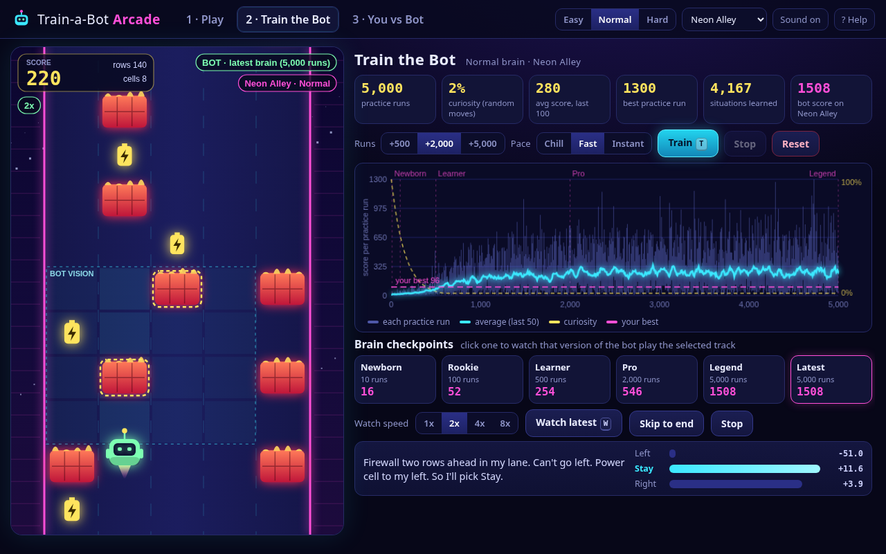

# Train-a-Bot Arcade

An offline arcade game with a "watch the AI learn" lab, built for Char and Vic. First **you** steer a little robot up a 5-lane neon road, dodging firewalls and grabbing power cells. Then you **train a bot** to play the same game with real tabular Q-learning, watch its score chart climb, look inside its "brain" while it plays, and find out who wins on the exact same seeded track.

It ships as one HTML file with no network requests, no CDN and no accounts. Scores and trained brains save in `localStorage`.



## Modes

- **Play:** pick one of five named tracks (Neon Alley, Byte Canyon, Glitch Gulch, Char's Circuit, Vic's Velocity) or a Surprise seed, and pick Easy, Normal or Hard. Each row you survive is +1 and each power cell is +10. The road speeds up the longer you last. Sliding sideways into a firewall that's right beside you counts as a crash. Turn on **Race the bot's ghost** to see the trained bot's run on the same track as a pink ghost, with a marker where it crashed.
- **Train the Bot:** add +500, +2,000 or +5,000 practice runs at a Chill (~18 s), Fast (~5 s) or Instant pace. The live chart shows the score for every run, a 50-run moving average, the curiosity (epsilon) curve, checkpoint markers and your best score as a line. A live practice feed plays on the game canvas while it trains. **Checkpoints** (Newborn at 10 runs, Rookie at 100, Learner at 500, Pro at 2,000, Legend at 5,000, plus Latest) save copies of the brain so you can replay any of them. In **watch mode** the bot plays at 1x, 2x, 4x or 8x with its vision box drawn on the road and a "thoughts" panel that shows what it sees, its Q-values for Left, Stay and Right, and the move it picks.
- **You vs Bot:** your best against the bot's best on the same seed, a bar chart of how each checkpoint scores on that track, and a table across all five tracks with the leader on each. One click starts a ghost race.
- Title screen with an attract-mode demo bot, a help modal (H), mute (M) and pause (P).

## How the bot learns

The bot uses tabular Q-learning, implemented in `web/core.js` and shared with Node.

- **State:** for its own lane and the two lanes on each side, the distance to the next firewall (wall/blocked, 1, 2, 3-4 or clear within 4 rows), plus which way the nearest power cell is. That gives 5^5 × 4 = 12,500 states with 3 actions each.
- **Reward:** +1 per row, +10 per cell, -100 for a crash and -2 for bumping the guard rail.
- **Update:** α = 0.3 and γ = 0.88. Epsilon starts at 1.0 and decays as `exp(-episodes/150)` down to 0.02. Every update is also applied to the **left-right mirrored** state, which doubles the data from each run.
- **Results:** typical Normal-mode results across the five tracks are about 30 points at 10 runs, about 50 at 100, 100-250 at 500, 500-1,500 at 2,000 and 700-1,500+ at 5,000. Training runs fast (thousands of episodes take about 100 ms). The pacing only exists so you can watch it learn.
- **Brains:** each difficulty has its own brain. **Reset** wipes the brain for the current difficulty.

## Run

```bash
./run.sh start     # build + serve http://127.0.0.1:4356/  (health: /healthz; port via TBA_PORT)
./run.sh test      # build + smoke test (offline checks, node trainer check, server health, headless Chrome playthrough)
./run.sh shots     # 1280x800 screenshots -> screenshots/
./run.sh all       # build + shots + test + start
./run.sh stop | restart | status | build
```

The offline single file is `dist/train-bot-arcade.html`, with an identical copy at `dist/index.html`. Double-click it to play. No server needed.

## Keys

| Action | Keys |
|---|---|
| Switch lanes | Left/Right arrows or `A` / `D` (one lane change per row) |
| Start / retry | `Space` / `Enter` |
| Pause | `P` |
| Train / watch bot | `T` / `W` |
| Tabs | `1` Play · `2` Train · `3` You vs Bot |
| Mute / help / close | `M` / `H` or `?` / `Esc` |

## Layout

| Path | Role |
|---|---|
| `web/core.js` | Deterministic seeded tracks, game rules, Q-learning agent, mirror table. Pure JS, used by the browser and Node |
| `web/app.js` | Canvas rendering, game, training and watch loops, charts, compare view, WebAudio blips, saves, and the `window.__TBA__` test API |
| `web/index.html`, `web/app.css` | Layout and neon styling |
| `build.py` | Inlines web/ into `dist/train-bot-arcade.html` and `dist/index.html` |
| `server.py` | Stdlib server on **4356** with `/healthz` |
| `tests/smoke_test.py` | Offline-bundle checks, a Node check that the trainer learns, server health, and a headless Chrome playthrough (`tests/play.mjs` via `tests/cdp.mjs`) |
| `tests/shots.py`, `tests/_shots_run.mjs` | Screenshot tour. The hero shot is `screenshots/00-best-watch-bot-learn.png` |

## Known gaps

- Tabular Q-learning only (no neural net or PPO). The bot sees just 4 rows ahead, so on dense Normal and Hard tracks it still hits occasional dead ends that need more lookahead.
- Brain checkpoints are saved per difficulty. Training more after Legend doesn't create new checkpoints, only "Latest" moves.
- There are no on-screen touch controls yet, so play needs a keyboard. Train, watch and compare all work with a mouse or touch.


---
## Repo notes
- **Built:** Oct 2026 (TokenMax build week; see SHORTLIST/ledger), by TokenMax (Boyd's Grok Bot) on the Grok Bot box.
- **Run:** `./run.sh` (then open the localhost URL it prints).
- Imported from `/workspace/tokenmax/train-bot-arcade` on Oct 23, 2026. node_modules, virtualenvs, logs and files over 20 MB were left out.
